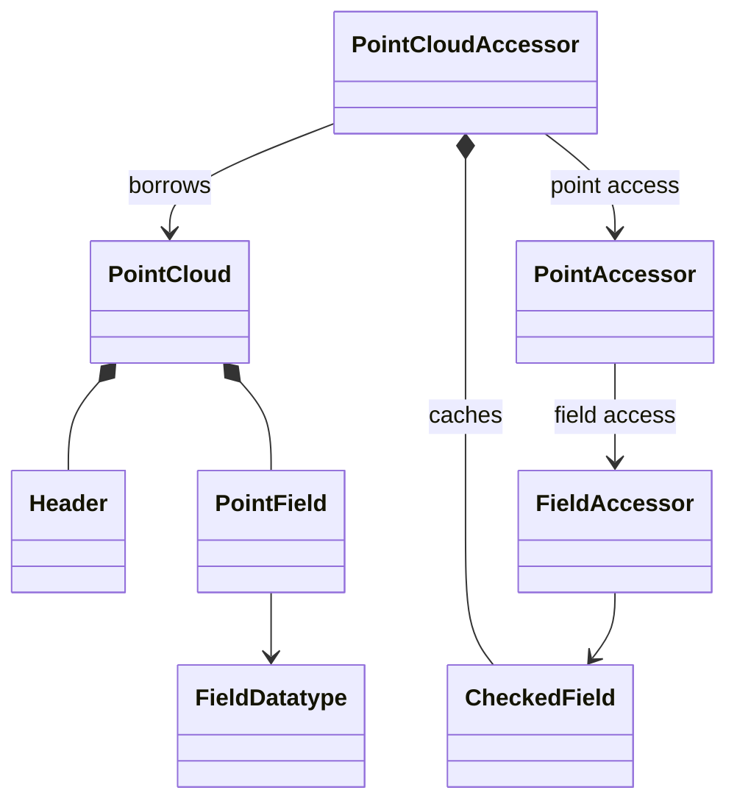
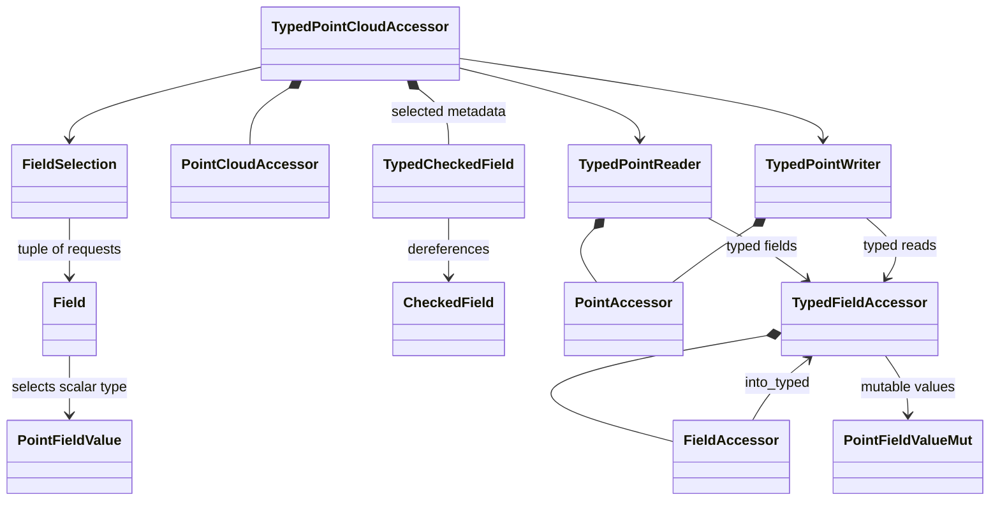

# Autoware common types

This `no_std` crate defines shared Autoware message, geometry, transform, and
point-cloud access types. It uses `alloc`.

## Data types

### Messages and geometry

| Type | Purpose |
| --- | --- |
| `Header` | A `frame_id` and `timestamp` attached to a message. |
| `PointCloud` | A public, ROS-style binary point-cloud message: header, dimensions, field descriptors, byte order, point and row strides, data, and density flag. Its public fields are not validated on construction. |
| `PointField` | A message descriptor for one named field: its byte offset, `FieldDatatype`, and number of consecutive values per point. Offsets and counts are `u32`. |
| `FieldDatatype` | The runtime encoding of a field: signed or unsigned 8-, 16-, or 32-bit integers, `f32`, or `f64`. |
| `PointFieldValue` | A sealed trait implemented by those eight Rust scalar types. It provides their datatype, size, and native-endian encoding and decoding. |
| `Point32` | A `Vector3<f32>` used as a polygon vertex. |
| `Polygon` / `PolygonStamped` | A sequence of 3D vertices, optionally paired with a `Header`. |
| `Transform` | A rigid transform with `f64` translation and a unit quaternion. `try_new` validates finite inputs and a near-unit quaternion, then normalizes it. |
| `TransformStamped` | A transform accompanied by a header and child frame ID. |
| `TransformListener` / `MockTransformListener` | An interface for transform lookup and an in-memory implementation for tests or other callers. |

`nalgebra::Quaternion::new` uses `(w, x, y, z)` order, unlike ROS's
`(x, y, z, w)` convention. `Transform::try_from_ros_xyzw` is a deprecated
compatibility helper; prefer explicit conversion at the I/O boundary.

### Point-cloud access

Point-cloud messages might not be well-formed and their fields could be corrupted.
To ensure a safe point-cloud manipulation, we provide **accessors** that uses Rust's typesystem to ensure a correct behavior.


The accessor types borrow a message and validate its layout before access.
They do not change message metadata while borrowed.

| Type | Purpose |
| --- | --- |
| `PointCloudAccessor<C>` | Owns resolved field metadata and cached dimensions and strides while borrowing a cloud. `PointCloudReader` and `PointCloudWriter` are aliases for shared and exclusive borrows. |
| `CheckedField` | Validated field layout without a statically selected Rust value type. |
| `PointAccessor<'a, D>` | A borrowed point and its checked metadata. `PointReader` and `PointWriter` expose shared or mutable bytes and named field access. |
| `FieldAccessor` | A borrowed field's complete byte slice and checked metadata. |
| `PointCloudError` / `PointFieldError` | Cloud layout and access errors; field-specific errors are propagated through `PointCloudError::InvalidField`. |



#### Layout and selection rules

Cloud construction requires native byte order, a nonzero `point_step`,
`row_step >= width * point_step`, and exactly `row_step * height` data bytes.
Row padding is allowed. Selected field ranges must fit inside a point; field
overlaps and zero-count fields are allowed. A point is accessed by row-major
index or by `(row, column)`; its bytes exclude row padding.

* `PointCloudReader::try_new(&cloud, None)` resolves every field descriptor.
* `Some(&[(name, datatype), ...])` resolves only the requested fields, in
  request order. The first descriptor with each name is used; a missing name
  or datatype mismatch is an error. Unselected descriptors are not validated.
* `Some(&[])` resolves no fields but still validates the cloud layout and
  permits access to raw point bytes.

### Typed point-cloud access

Typed access uses the same validated layouts while retaining the selected Rust
types. A raw field can also be converted individually with `into_typed::<T>()`,
which checks its datatype.

| Type | Purpose |
| --- | --- |
| `Field<T>` / `FieldSelection` | A named typed field request and the sealed tuple-selection interface. Tuples contain one to eight fields and can mix scalar types. Every selected field retains all of its values. |
| `TypedCheckedField<T>` | Checked field metadata plus a type witness for `T`; used internally by typed selections. It dereferences to `CheckedField`. |
| `TypedPointCloudAccessor<C, S>` | A cloud accessor with typed selection metadata `S`. `TypedPointCloudReader` and `TypedPointCloudWriter` are shared and exclusive aliases. |
| `TypedPointReader` / `TypedPointWriter` | A point with typed tuple access. A writer supports typed reads and ordered tuple writes. |
| `TypedFieldAccessor` | A typed field view supporting scalar reads, iteration, and, for mutable bytes, writes. Values are decoded from native-endian bytes rather than borrowed as aligned `T` references. |
| `PointFieldValueMut<T>` | A mutable proxy for one possibly unaligned value, returned when iterating over a mutable typed field. |



#### Typed selection and writes

* `try_new_typed` takes a tuple of `Field::<T>::new(name)` requests and checks
  the names and types at construction. Point access then returns typed handles
  without repeating name or datatype lookups. Bounds and byte ranges are still
  checked when accessing values.

For tuple writes, `write_values(index, values)` writes the same element index
in each selected field; `write_fields(slices)` writes all values and requires
each slice length to match its field count. Both validate all requested writes
before mutation. Writes occur left to right, so a later tuple element wins if
fields overlap or a field is selected more than once.

```rust
use common_types::point::{Field, PointCloud, PointCloudError, PointCloudReader, PointCloudWriter};

fn read_xyz(cloud: &PointCloud) -> Result<(f32, f32, f32), PointCloudError> {
    let reader = PointCloudReader::try_new_typed(
        cloud,
        (Field::<f32>::new("x"), Field::<f32>::new("y"), Field::<f32>::new("z")),
    )?;
    let (x, y, z) = reader.point(0)?.fields();
    Ok((x.value(0)?, y.value(0)?, z.value(0)?))
}

fn write_xyz(cloud: &mut PointCloud) -> Result<(), PointCloudError> {
    let mut writer = PointCloudWriter::try_new_typed(
        cloud,
        (Field::<f32>::new("x"), Field::<f32>::new("y"), Field::<f32>::new("z")),
    )?;
    writer.point_mut(0)?.write_values(0, (1.0, 2.0, 3.0))
}
```

## Validation

From the repository root:

```sh
cargo build -p common_types --all-targets --all-features
cargo test -p common_types --all-features
cargo clippy -p common_types --all-targets --all-features -- -D warnings
```

Tests cover layout and typed access, ordered overlapping writes, empty clouds,
transforms, metadata, extra values, unaligned fields, and padded input rows.

See the [crop box filter](../crop_box_filter/README.md) for a consumer of these
types.
